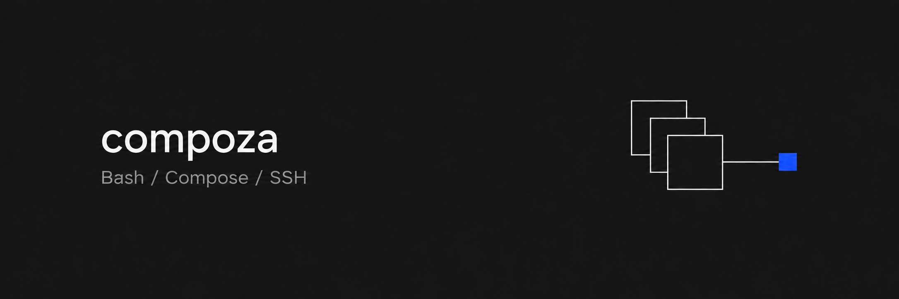

# compoza

<p align="center">
  
</p>

Deploy Docker Compose stacks to remote machines over SSH. Build and deliver images, manage secrets, check health, and roll back versioned releases.

A good fit for side projects, home labs, and apps you run on a VPS from providers like Hetzner, OVHcloud, or DigitalOcean. Bring your own server and Compose files; Compoza handles the deployment workflow.

Any repository opts in by adding a `deploy.yaml` beside its Compose files. A separate host inventory can live globally on the operator's machine or in a repository-local `hosts.yaml`.

Docker and Compose are the core. Credential providers (dotenv and 1Password) and ingress (Caddy and Cloudflare Tunnel) are [bundled extensions](docs/development.md#extensions), with interfaces for adding other implementations.

For differences in deployment behavior, operational scope and trade-offs, see [Comparing Kamal, Dokploy, Coolify and Compose](docs/comparisons.md).

[Quickstart](#quickstart) · [Commands](#commands) · [Agent skills](#agent-skills) · [Documentation](#documentation)

## What it does

- **Checks readiness** before changing anything, such as DNS, the proxy, its network, registry login and host Docker access.
- **Builds and ships images** tagged with the commit, through a registry, `docker save` over SSH, or a build on the host itself.
- **Runs Compose** from this machine against the host's Docker endpoint (the default), or on the host from a versioned release that supports rollback.
- **Templates Caddy configuration** with bundled defaults, custom site and shared Caddyfile templates, and per-app overrides. [Template settings](docs/caddy-templates.md).
- **Provisions Caddy** with an opt-in host `ingress.caddy.provision` block, including persistent storage, health checks, bounded logs, graceful shutdown and DNS challenge settings. Existing proxies remain supported.
- **Provisions Cloudflare connectors** with a digest-pinned image, private credentials from 1Password or dotenv, connection readiness and customizable Compose/route templates. Supports dashboard-managed routes without an API token. [Cloudflare provisioning](docs/cloudflare-provisioning.md).
- **Routes traffic** through shared Caddy or an existing Cloudflare Tunnel, then waits for the URL to answer.
- **Resolves secrets** from a dotenv file or a 1Password Environment, without putting values in configuration.
- **Manages the lifecycle**: status, logs, stop, start, delete, rollback and publishing static content.

## Install

Requires Node.js 22.18 or newer. Install the CLI globally with pnpm:

```sh
pnpm add -g compoza
compoza --help
```

The `compoza` command is then available from any app repository. For running from source, see the [development guide](docs/development.md).

A normal install includes the optional 1Password SDK. Dotenv secrets, ordinary checks and dry runs also work without optional dependencies.

When upgrading an installation from before the Compoza rename, install the CLI as above, update scripts to call `compoza`,
and move the global host inventory to `~/.config/compoza/hosts.yaml` (or select it explicitly with `--hosts`).
Update operator environment variables to `COMPOZA_HOSTS` and `COMPOZA_1PASSWORD_ACCOUNT` where used.
Deploy a fresh SSH release before using lifecycle commands or rollback with Compoza; archived releases must carry
the `compoza-runtime-v2` marker. Complete any operations with the previous CLI before switching, because the
renamed Caddy locks do not coordinate with older processes.

## Quickstart

Deploy the [official nginx image](https://hub.docker.com/_/nginx) to a fictional host using SSH execution. With `targets: []`, no Git checkout, Dockerfile or build context is needed. The host must be able to pull the image.

Replace the host, account, address and paths with your own.

The host needs key-based SSH access, Docker Engine with a Compose version that supports `up --wait`, Bash 3.2+, jq 1.6+, `base64` and curl. See [host prerequisites](docs/ssh-deployment.md#host-prerequisites) for the full list.

### 1. Describe the host

Configure global hosts in `~/.config/compoza/hosts.yaml`. A `./hosts.yaml` in the current working directory overrides hosts by name. Use `--hosts` or `COMPOZA_HOSTS` to select a single file instead. Entries can also reference [external host files](docs/configuration.md#external-host-files) with `$ref: ~/infrastructure/atlas.yaml`:

```yaml
juniper:
  ssh: deploy@juniper.example.com
  platform: linux/amd64
  transport:
    mode: ssh-load
```

### 2. Describe the app

Create `infra/deploy.yaml` in the app repository:

```yaml
name: hello-web
host: juniper
targets: []
execution: ssh
composeFiles:
  - compose.yaml
secrets:
  none: {}
remote:
  stackDir: /home/deploy/stacks/hello-web
  waitTimeoutSeconds: 120
ingress:
  none: {}
health:
  url: http://127.0.0.1:8080/
  timeoutSeconds: 60
```

### 3. Add the Compose file

Create `infra/compose.yaml` beside it:

```yaml
services:
  web:
    image: nginx:alpine
    ports:
      - '127.0.0.1:8080:80'
```

### 4. Check, preview and deploy

```sh
compoza check infra --json       # read-only readiness report
compoza deploy infra --dry-run   # print the plan without changing anything
compoza deploy infra             # stage a release and run Compose on the host
compoza status infra
compoza logs infra --service web --tail 50
```

The app listens on the host at `http://127.0.0.1:8080/`. The deploy checks that URL over SSH and promotes the release only after it answers. This example keeps the port private to the host.

> [!NOTE]
> The quickstart explicitly opts into `execution: ssh`. When `execution` is omitted, the default is **client** execution: Compose runs on this machine against `docker --host ssh://<host>`. Versioned releases and `rollback` are available only with SSH execution.

## Execution and image transport

Two independent settings decide how a deploy runs:

| Setting                 | Values                                 | Effect                                                                                                 |
| ----------------------- | -------------------------------------- | ------------------------------------------------------------------------------------------------------ |
| `execution` (app)       | `client` (default), `ssh`              | Run Compose from this machine, or upload a versioned release and run the host's own Compose            |
| `transport.mode` (host) | `registry`, `ssh-load`, `remote-build` | Push and pull via a registry, pipe `docker save` over SSH, or build on the host (`ssh` execution only) |

`--local` always builds into this machine's Docker and starts the stack here, whatever the execution mode. See [Configuration](docs/configuration.md#execution-and-transport) and [SSH deployment](docs/ssh-deployment.md) for the details.

## Commands

| Task                     | Command                                            |
| ------------------------ | -------------------------------------------------- |
| Check readiness          | `compoza check <folder> --json`                    |
| Preview / deploy         | `compoza deploy <folder> [--dry-run]`              |
| Inspect services         | `compoza status <folder>`                          |
| Follow logs              | `compoza logs <folder> --service <name> --follow`  |
| Stop / resume            | `compoza stop <folder>` / `compoza start <folder>` |
| Roll back an SSH release | `compoza rollback <folder> [--release <id>]`       |
| Remove a stack           | `compoza delete <folder> [--volumes]`              |
| Mirror content           | `compoza publish <folder> <section> <source>`      |
| Set up host ingress      | `compoza setup-proxy <host> [--dry-run]`           |

Use `compoza <command> --help` for all flags. `rollback`, `stop`, `start`, `delete` and `publish` also accept `--dry-run`.

`<folder>` holds `deploy.yaml` (or is the file itself) and defaults to the working directory, except for `publish`, which requires it. Every app command accepts `--destination <name>`. `delete` is also available as `down`.

## Operational notes

- **A dry run is not proof.** It runs read-only probes and prints the plan, but the candidate Compose model cannot be fully validated against host files until it is staged.
- **Failures can be partial.** A failed Compose run, route or health check can leave candidate containers or routes active. There is no automatic container rollback, and data migrations are never reversed. Inspect `status` and `logs`, then recover explicitly.
- **Rollback keeps the current secrets.** It restores an earlier release's configuration and images with the currently active secret source, never an archived one.
- **`deploy --tag <tag>` uses the current local configuration.** It reuses existing images and skips Git and builds; it does not restore an earlier Compose release.
- **Keep secrets out of configuration.** Never put them in `deploy.yaml`, `environment`, assets or build contexts; exclude dotenv files from build contexts with `.dockerignore`.
- **Data stays.** `delete` keeps host folders and bind data; named volumes are removed only with `--volumes`.

## Agent skills

Two workflows are included for Codex and Claude Code:

| Agent       | Skill folders                                       | Invoke                |
| ----------- | --------------------------------------------------- | --------------------- |
| Codex       | `.agents/skills/deploy/`, `.agents/skills/compoza/` | `$deploy`, `$compoza` |
| Claude Code | `.claude/skills/deploy/`, `.claude/skills/compoza/` | `/deploy`, `/compoza` |

- **`deploy`** guides a deployment through target selection, readiness checks, preview, deployment and verification.
- **`compoza`** handles operations such as status, logs, rollback, stop/start, deletion and content publishing.

Install the CLI first. To use the skills in another repository, copy the **entire folders**, including Codex metadata:

```sh
# Run from this checkout; replace /path/to/app with the target repository.
mkdir -p /path/to/app/.agents/skills
cp -R .agents/skills/deploy .agents/skills/compoza /path/to/app/.agents/skills/
```

[Codex discovers repository skills](https://developers.openai.com/codex/skills) under `.agents/skills/`. Both support explicit invocation and automatic selection. They are not installed globally. For Claude Code, copy the corresponding folders into `.claude/skills/`; `/deploy` remains explicitly invoked.

## Documentation

| Document                                                   | Covers                                                                                                   |
| ---------------------------------------------------------- | -------------------------------------------------------------------------------------------------------- |
| [Comparing deployment tools](docs/comparisons.md)          | Kamal, Dokploy, Coolify and Compose: deployment models, strengths, limits and when to choose each        |
| [Configuration](docs/configuration.md)                     | `hosts.yaml`, `deploy.yaml`, destinations, execution and transport, client deploys, lifecycle, `publish` |
| [Ingress](docs/ingress.md)                                 | Provider selection, Caddy host/app settings and setup, Cloudflare Tunnel, route ownership and migration  |
| [Caddy templates](docs/caddy-templates.md)                 | File and inline templates, placeholders, app overrides and custom proxy headers                          |
| [Caddy production operations](docs/caddy-production.md)    | Hardening defaults, monitoring, backups, recovery and existing-host migration                            |
| [Cloudflare provisioning](docs/cloudflare-provisioning.md) | Host connector setup, native credentials, manual routes, hardening and Compose/route templates           |
| [Secrets](docs/secrets.md)                                 | Providers, 1Password authentication, dotenv rules, collisions, access checks, SSH snapshots              |
| [SSH deployment](docs/ssh-deployment.md)                   | Host prerequisites, release layout, assets, validation and privacy, upgrades, rollback, recovery         |
| [Development](docs/development.md)                         | Source layout, checks, tests and host-runtime conventions                                                |
